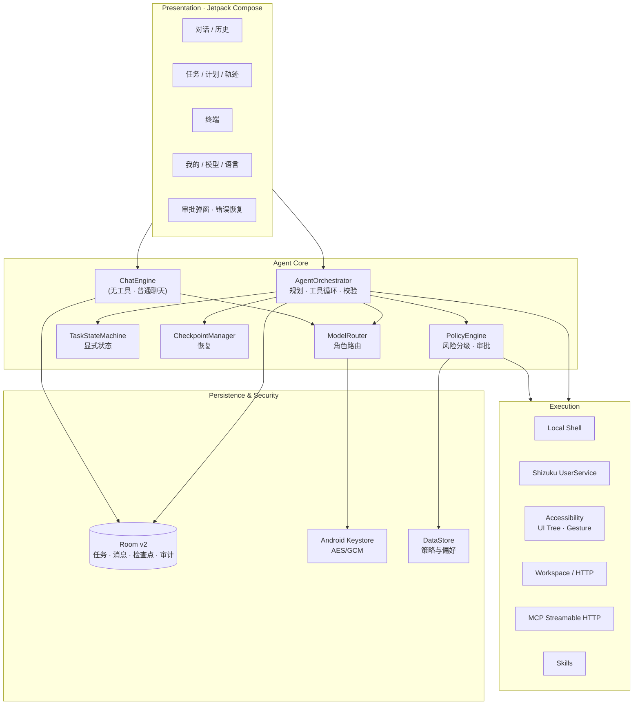
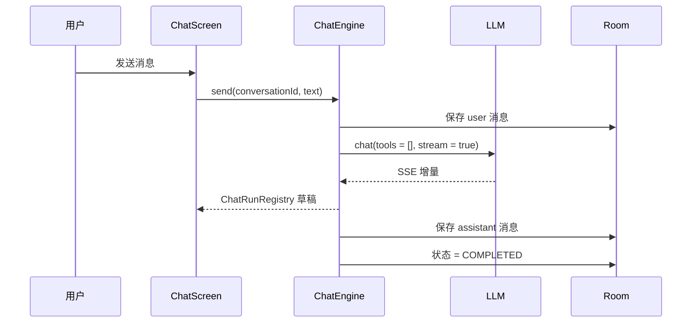

# Mobile Agent

**运行在 Android 手机上的原生 AI 智能体：能聊天，也能真正执行任务。**

[](https://developer.android.com)
[](https://kotlinlang.org)
[](https://developer.android.com/jetpack/compose)
[](#验证状态)
[](#license)

Mobile Agent 不是一个聊天壳。它把自然语言目标拆成可执行步骤，通过受权限策略约束的工具操作手机与网络，校验结果，并把每一步写入可恢复的任务日志。无 Root；Shizuku 与无障碍是显式授权的可选能力。

```text
自然语言 → 规划 → 模型选择工具 → 策略审批 → 执行 → 观察/校验 → 检查点 → 汇报
```

---

## 为什么又做一个 Agent？

大多数「手机 AI」只是把网页聊天包一层。真正难的是**执行**：权限边界、失败恢复、可追溯性，以及当模型、网络或设备能力不可用时，仍然诚实地说清楚发生了什么。

Mobile Agent 的设计取舍：

- **原生 Kotlin + Compose**：前台服务、WorkManager、无障碍、Shizuku 都是系统能力，不靠 WebView 模拟。
- **纯聊天与 Agent 执行分离**：普通对话不发送任何工具、不依赖 MCP/Shizuku/无障碍；只有切到 Agent 模式才进入工具链。
- **策略门禁唯一入口**：模型不能绕过审批、不能自行提权，高风险动作逐次确认。
- **可恢复而非“重试一下”**：每次工具调用后落检查点；进程被杀后任务暂停，恢复时先校验副作用，绝不盲目重放。
- **能力只显示验证结果**：模型能力来自真实探测，未验证不冒充支持。

## 本版本重点：DeepSeek 修复

v0.1.0 修复了一个阻断性缺陷：**配置 DeepSeek 后无法进行任何对话**。

根因不是 Key 或网络，而是协议细节：

1. Agent 每次请求携带全部工具，工具名使用 `file.read`、`device.info` 这类**带点号**的名称；
2. DeepSeek 官方规定 function name 只能包含 `a-z A-Z 0-9 _ -`，请求在模型前即被 **400** 拒绝；
3. Harness 吞掉了服务端错误，只显示笼统的“模型请求失败”；
4. 旧版没有普通聊天链路，连打招呼也会走工具链。

修复：工具名 wire 层清洗与反向映射、独立聊天引擎（`tools = []`）、分阶段连接测试、按官方文档更新的服务商预设、可诊断的错误分类。

📄 完整排查、证据与人工验收步骤：[`docs/DEEPSEEK_FIX.md`](docs/DEEPSEEK_FIX.md)

---

## 架构



### 普通聊天 vs Agent 执行



Agent 模式才进入规划、工具注册、Schema 校验、策略审批、执行、验证、检查点与恢复。两条链路共享模型客户端与服务商配置，但不共享执行状态。

更多设计：[`docs/ARCHITECTURE.md`](docs/ARCHITECTURE.md)

---

## 功能一览

| 能力 | 状态 | 说明 |
| --- | --- | --- |
| 普通多轮聊天 | ✅ 实现 + 单测 | 无工具、流式、停止、重新生成、历史会话 |
| OpenAI 兼容模型 | ✅ 实现 + Mock 测试 | SSE、tool calling、usage、能力探测 |
| DeepSeek 适配 | ✅ 协议修复 | 官方地址/模型预设；普通聊天关闭 thinking |
| 服务商向导 | ✅ 实现 | 7 个预设；Key 加密；六阶段连接测试 |
| Agent 循环 | ✅ 实现 | 计划、工具、校验、检查点、恢复 |
| 本机 Shell | ✅ 实现 | app UID，超时/取消/输出上限/危险命令拦截 |
| Shizuku ADB | ✅ 实现 · ⚠️ 未真机验证 | Messenger UserService，shell UID，逐次确认 |
| 无障碍 UI 自动化 | ✅ 实现 · ⚠️ 未真机验证 | UI 树、点击、输入、滚动、等待、截图 |
| HTTP / 文件 / 设备 | ✅ 实现 | SSRF 防护、工作区沙箱、真实设备值 |
| MCP | ✅ 实现 | Streamable HTTP；stdio 明确不可用 |
| Skills | ✅ 实现 | YAML 校验、zip 导入、6 个内置技能 |
| 定时任务 | ✅ 实现 | WorkManager，≥15 分钟 |
| 中文 / English | ✅ 主流程资源化 | 部分旧页面仍待迁移 |
| 真机验收 | ⚠️ 未执行 | 无设备、无真实 API Key |

---

## 快速开始

### 构建

```bash
# 需要 JDK 21 + Android SDK 36
export JAVA_HOME=/path/to/jdk-21
export ANDROID_HOME=$HOME/Android/Sdk
./gradlew :app:assembleDebug
```

Windows：

```powershell
$env:JAVA_HOME = "C:\Program Files\Android\Android Studio\jbr"
$env:ANDROID_HOME = "$env:LOCALAPPDATA\Android\Sdk"
.\gradlew.bat :app:assembleDebug
```

产物：`app/build/outputs/apk/debug/app-debug.apk`。

### 安装与首次配置

```bash
adb install -r app/build/outputs/apk/debug/app-debug.apk
```

1. 打开应用 → 选择 **DeepSeek**；
2. 粘贴 API Key；
3. 模型保持 `deepseek-flash`；
4. 点击 **测试连接**，必须看到“收到真实文本回复”；
5. 点击 **保存并开始聊天**。

不配置 Shizuku / 无障碍也能正常聊天。详细步骤：[`docs/INSTALL.md`](docs/INSTALL.md) · [`docs/USER_GUIDE.md`](docs/USER_GUIDE.md) · [`docs/API_CONFIG.md`](docs/API_CONFIG.md)。

---

## 验证状态

| 项目 | 结果 |
| --- | --- |
| `:app:assembleDebug` | ✅ 通过（Gradle 8.13 / AGP 8.11.1 / Kotlin 2.1.21 / JDK 21） |
| JVM 单元测试 | ✅ **48 / 48 通过** |
| DeepSeek 形状请求（Mock） | ✅ 路径、鉴权、模型、无 `stream_options`、无非法工具名、SSE、401、空内容 |
| 工具名清洗 | ✅ `file.read → file_read`，响应映射回内部工具 |
| 真实 DeepSeek Key 对话 | ❌ 未执行（无可用凭据） |
| 真机 / 模拟器启动 | ❌ 未执行（无设备；本机镜像不完整） |
| Shizuku / 无障碍 / WorkManager | ❌ 未真机验证 |
| Compose UI 自动化 | ❌ 未执行 |

> 本项目坚持区分「代码完成」「编译通过」「单测通过」「真机可用」。当前属于前三项，**不等于真机可用**。

### 运行测试

```bash
./gradlew test
```

Windows 中文路径下 Gradle 的 `@argfile` 编码会导致测试类加载失败（`initializationError`），使用：

```powershell
powershell -ExecutionPolicy Bypass -File .\scripts\run-tests-ascii.ps1
```

---

## 安全模型

- **无 Root**；Shizuku 仅提供 ADB shell UID，不是提权后门。
- **API Key** 使用 Android Keystore AES-256/GCM 加密，仅密文落盘；不进入数据库、日志、检查点或导出。
- **风险分级**：LOW / MEDIUM / HIGH / CRITICAL；HIGH 与 CRITICAL 默认逐次确认，超时视为拒绝。
- **硬拒绝**：未授权的 Shizuku、未连接的无障碍、未开启的云端截图、私网 HTTP、灾难性 Shell 命令。
- **工作区隔离**：文件工具只能访问应用私有 workspace，路径逃逸会被拒绝。
- **审计可追溯**：任务、工具调用、事件、检查点均落库；导出前脱敏。

漏洞报告与威胁模型：[`SECURITY.md`](SECURITY.md)。

---

## 工程结构

```text
mobile-agent/
├── app/                 Compose UI、导航、首次配置、前台服务、WorkManager
├── core/                模型、Room、LLM 客户端、ChatEngine、Agent Harness、策略、记忆
├── execution/           本机 Shell、Shizuku、无障碍、工作区、设备/文件/HTTP/UI 工具
├── integrations/        MCP 客户端、Skills 加载与脚本运行、内置技能
├── docs/                架构、安装、用户手册、API、根因、测试、限制、路线图
├── scripts/             ASCII 测试脚本、APK 构建脚本
├── dist/                本地构建的 Debug APK（不提交 Git）
└── .github/             CI、Issue/PR 模板
```

依赖方向：`app → integrations → execution → core`。UI 不直接执行 Shell 或系统操作。

---

## 文档

| 文档 | 内容 |
| --- | --- |
| [架构设计](docs/ARCHITECTURE.md) | 模块、聊天/Agent 双链路、状态机、数据模型、安全门禁 |
| [安装指南](docs/INSTALL.md) | 环境、构建、安装、Shizuku/无障碍配置、排错 |
| [用户手册](docs/USER_GUIDE.md) | 首次配置、聊天、Agent、任务、模型、语言 |
| [API 配置](docs/API_CONFIG.md) | 服务商预设、请求构造、六阶段测试、错误对照 |
| [DeepSeek 修复](docs/DEEPSEEK_FIX.md) | 根因、证据、修复、人工验收步骤 |
| [UI/UX](docs/UI_UX.md) | 信息架构、对话体验、状态设计、国际化进度 |
| [测试报告](docs/TEST_REPORT.md) | 构建、48 个单测、APK 检查、未验证项 |
| [已知限制](docs/KNOWN_LIMITATIONS.md) | 运行时、国际化、功能边界、环境限制 |
| [路线图](docs/ROADMAP.md) | 下一阶段优先级 |
| [变更日志](CHANGELOG.md) | 版本记录 |

---

## 路线图

- **P0**：真机验证 DeepSeek 多轮对话；真机验证 Shizuku 与无障碍。
- **P1**：完成剩余页面资源化；Compose UI 测试；Room 迁移实测；截图与文件分享。
- **P2**：stdio MCP / 内置运行时；语义记忆；视觉闭环；费用统计；性能与启动优化。

详见 [`docs/ROADMAP.md`](docs/ROADMAP.md)。

---

## 参与贡献

欢迎 Issue 与 PR。开始前请阅读 [`CONTRIBUTING.md`](CONTRIBUTING.md)。提交前请确保：

- `./gradlew test :app:assembleDebug` 通过；
- 不引入 Root、绕过系统权限或未经审批的执行路径；
- 新增工具必须注册 Schema、风险等级与能力标记；
- 不提交任何真实 API Key、Token 或设备隐私数据。

## License

[MIT](LICENSE) © 2026 ForrestGump618

## 免责声明

本项目用于个人自动化与研究。请遵守所在地区法律、服务商条款与设备安全策略。
不要用它绕过锁屏、生物识别、应用访问控制或他人隐私边界。
