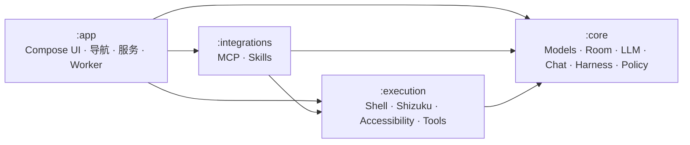
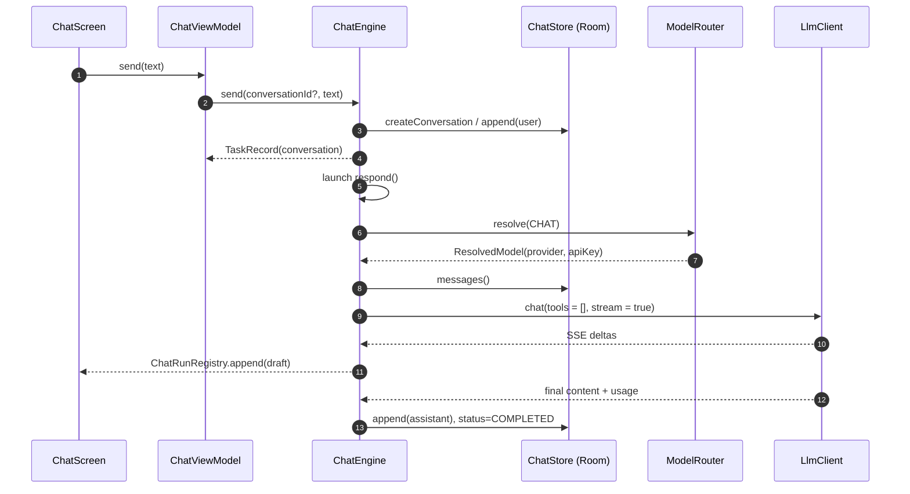
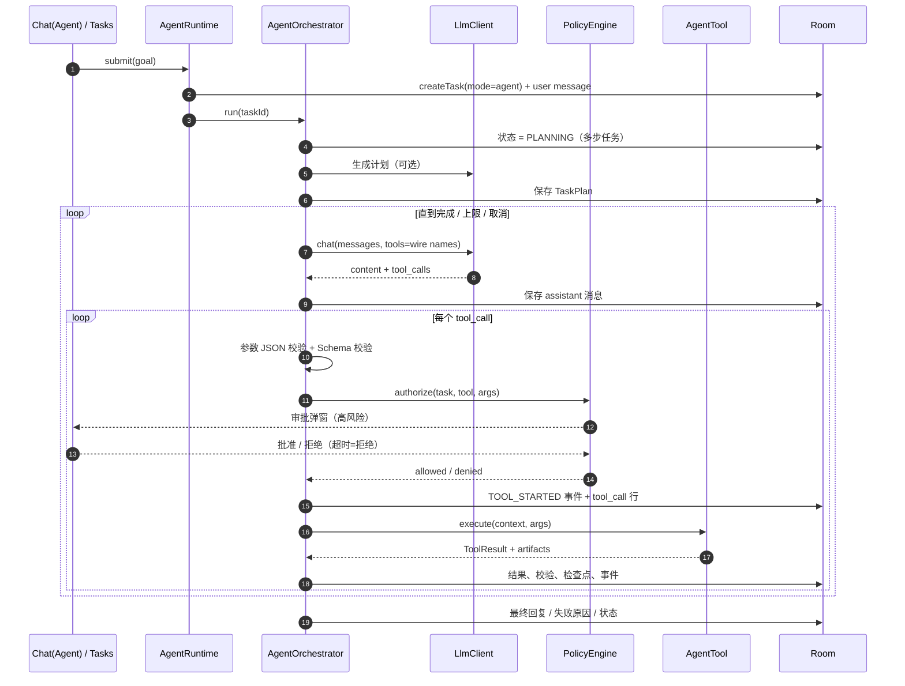
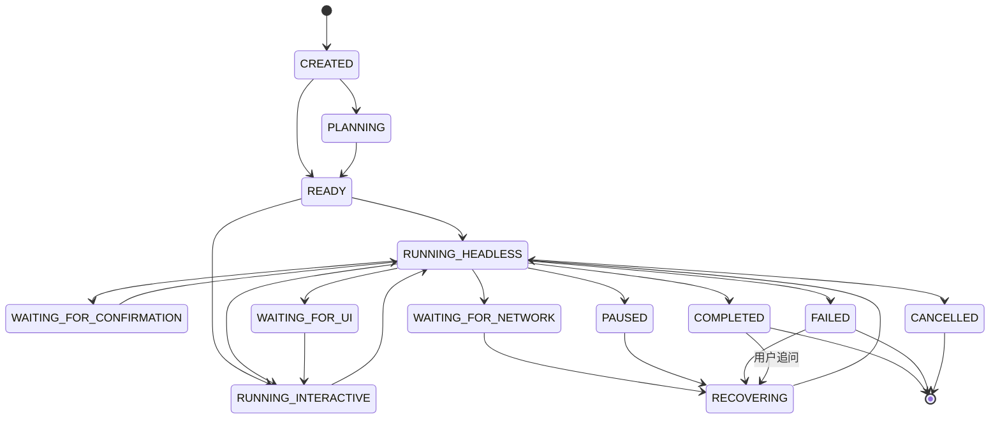
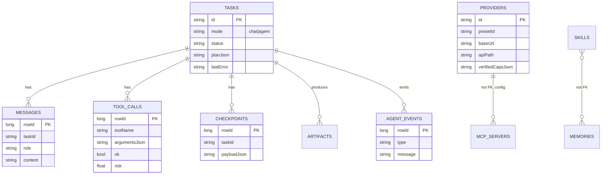
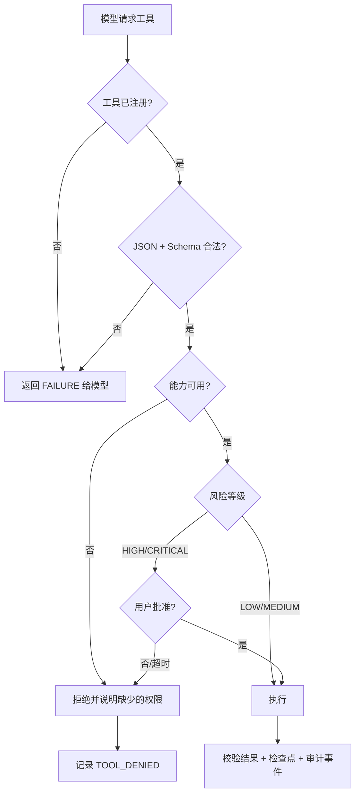

# 架构设计

本文说明 Mobile Agent 的模块边界、两条执行链路、状态与恢复语义，以及安全门禁的位置。

## 1. 设计目标

1. **真实执行**：每个事实来自工具结果，不伪造设备信息、命令输出或网页内容。
2. **可恢复**：长任务在任意步骤后都能重建上下文，且不会重复有副作用的操作。
3. **可解释**：每个决策、工具调用、审批与失败都有结构化记录。
4. **最小权限**：无 Root；Shizuku/无障碍必须显式开启；模型不能自行提权。
5. **能力诚实**：不可用的功能明确失败，不显示“假成功”。

非目标：绕过系统沙箱、锁屏、生物识别、应用访问控制；提供无认证的远程控制。

## 2. 模块与依赖

| 模块 | 职责 | 关键约束 |
| --- | --- | --- |
| `:core` | 领域模型、Room、仓库、LLM 客户端、ChatEngine、AgentOrchestrator、策略、记忆、诊断 | 不依赖 Android UI；工具只能通过 `AgentTool` 接口 |
| `:execution` | 本机 Shell、Shizuku UserService、无障碍桥、工作区、设备/文件/HTTP/UI/视觉工具 | 所有工具实现 `AgentTool`；路径/命令/URL 先自检 |
| `:integrations` | MCP Streamable HTTP 客户端、工具适配、Skills 解析/安装/脚本运行 | 远程工具注册进同一 `ToolRegistry` |
| `:app` | Compose 页面、导航、首次配置、`AppGraph`、前台服务、WorkManager、Boot 接收器 | UI 只观察状态，不直接执行系统操作 |

依赖方向单向：`app → integrations → execution → core`。

## 3. 两条执行链路

### 3.1 普通聊天（ChatEngine）

要点：

- `tools` 为空数组；不解析工具调用，不进入 PolicyEngine。
- 流式草稿只存在内存（`ChatRunRegistry`），完成后一次性落库，避免每 token 写数据库。
- 空回复、鉴权失败、网络/超时、流式中断都会进入确定终态并显示原因。
- 停止生成会保留已输出文本，并标记“已停止生成”。
- 重新生成删除最后一条 assistant 消息后重发同一上下文。

### 3.2 Agent 执行（AgentOrchestrator）

关键点：

- **工具名 wire 层清洗**：内部 `file.read` → 发送 `file_read`；模型返回后由 `ToolRegistry.resolveWireName` 映射回来。
- **先校验再授权**：未知工具、非法 JSON、Schema 不匹配都会作为工具错误回传给模型，而不是直接执行。
- **每个工具后落检查点**：包含计划、已完成步骤、产物路径、权限快照、最后错误与恢复策略。
- **上下文折叠**：恢复时把历史 transcript 折叠进系统消息，保证 assistant/tool 消息配对合法（孤立 tool 消息会被服务商拒绝）。

## 4. 任务状态机

`TaskStateMachine` 是唯一的合法转换表；非法转换被拒绝并记录 `DIAGNOSTIC`，不会被强制写入。

## 5. 数据模型

Room v2 提供 `1 → 2` 迁移：新增 `tasks.mode`、provider 预设/测试/错误字段，不使用 destructive fallback。

## 6. 安全门禁

硬拒绝条件：Shizuku 未运行/未授权、无障碍未连接、云端截图未开启、本机 Shell 被关闭、私网/回环 URL、灾难性命令模式。

## 7. 恢复语义

进程重启后：

1. 未完成的 schedule 重新注册到 WorkManager；
2. 处于运行中且无活动 Job 的任务标记为 `PAUSED`，记录事件；
3. 用户显式恢复 → `RECOVERING`；
4. 恢复提示包含“先校验副作用再重放”；
5. 启动过但未完成的工具调用（`ok == null`）会被列出，要求模型用只读工具确认结果；
6. 无法确认时任务保持失败/暂停，不自动重复非幂等操作。

## 8. 模型层

- `OpenAiCompatibleClient`：POST `{Base URL}{apiPath}`，Bearer 鉴权，SSE 解析（多行 data、注释、`[DONE]`、错误帧、JSON 回退）。
- 不发送 `stream_options`；DeepSeek 普通聊天发送 `thinking: disabled` 以降低首字延迟。
- 空内容、协议错误、401/403/404/429/5xx 都转为 `LlmException(kind, status, technical)`。
- `ModelRouter` 负责 chat / planning / execution / vision / summary 路由；视觉模型不回退到非视觉模型。
- `ConnectionTester` 六阶段验证；HTTP 200 但无文本不算成功。

## 9. 后台执行

- 前台服务（dataSync）仅在任务执行时存在，提供停止入口。
- WorkManager 周期任务（≥15 分钟）通过同一 `AgentRuntime` 创建普通 Agent 任务。
- Worker 等待完成最多约 9 分钟；更长任务依赖进程存活，否则下次启动变为暂停。
- Boot 接收器只恢复 schedule 与暂停中断任务，不利用开机广播绕过后台限制。

## 10. 扩展点

**新增工具**：

1. 实现 `AgentTool`，声明 `ToolSpec`（Schema、风险、类别、能力标记）；
2. 在 `AppGraph.registerTools()` 注册；
3. 高风险操作选择 `RiskLevel.HIGH`；
4. 为输出添加稳定的必填字段，便于 `ResultVerifier` 校验；
5. 添加单元测试（参数校验、错误路径）。

**新增服务商**：在 `ProviderPresets` 添加 base URL、apiPath、推荐模型与能力标记；不要根据模型名称猜测能力。

**新增技能**：`SKILL.md` + `skill.yaml`，声明 `required_tools`、权限与运行时；prompt 技能只提供指导，脚本技能必须检测真实运行时。

## 11. 测试策略

- 纯逻辑：状态机、参数 Schema、脱敏、审批、命令/URL 策略、YAML、工具名映射。
- 网络协议：MockWebServer 验证请求路径、鉴权、SSE、错误映射、DeepSeek 形状。
- 聊天引擎：Fake ChatStore + Fake LlmClient，验证无工具、多轮顺序、失败与空回复。
- 未覆盖：真机服务、Compose UI、Room 迁移实测。原因与后续计划见 `TEST_REPORT.md` 与 `ROADMAP.md`。
